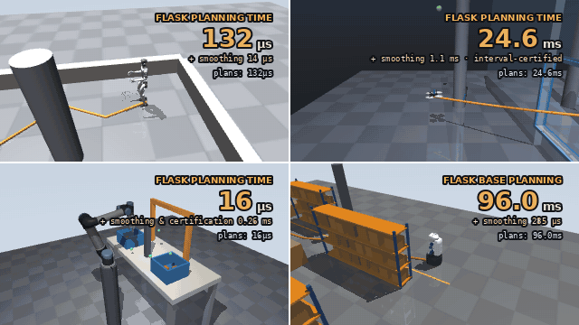
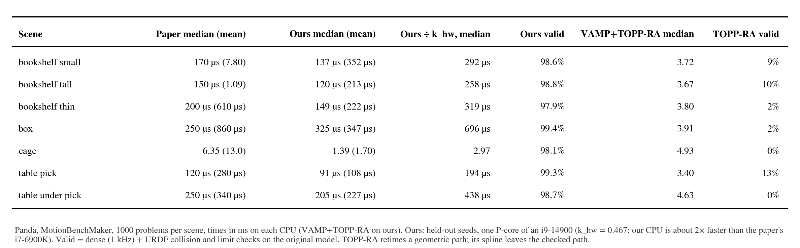
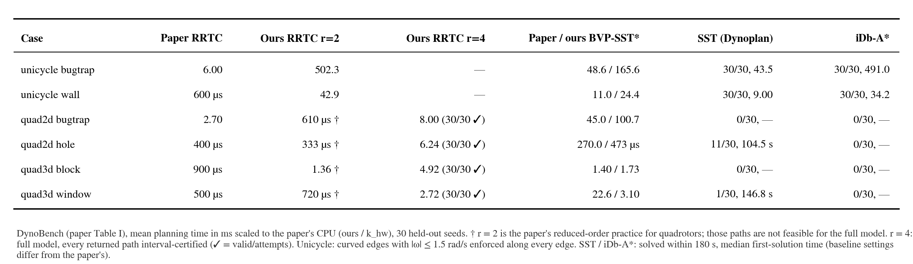
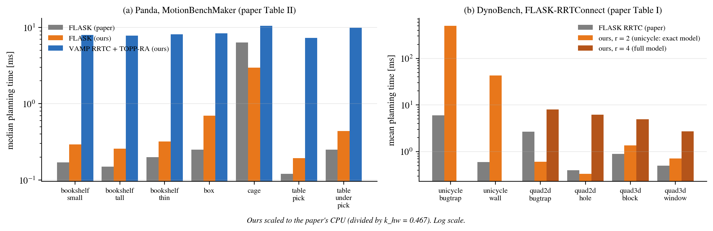
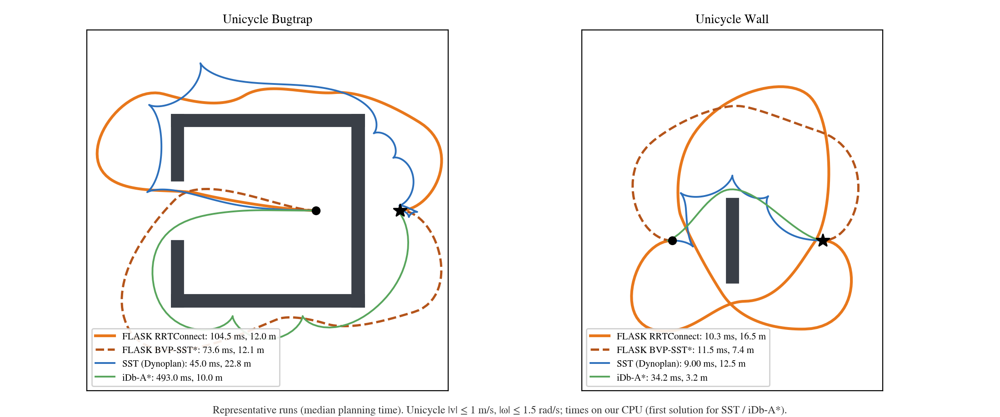
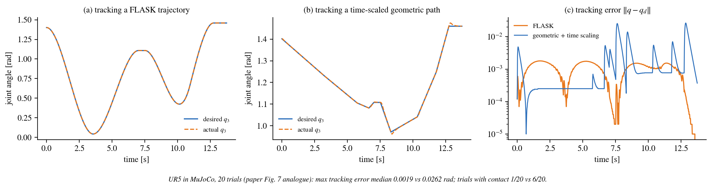
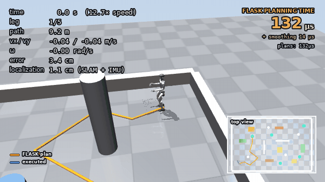
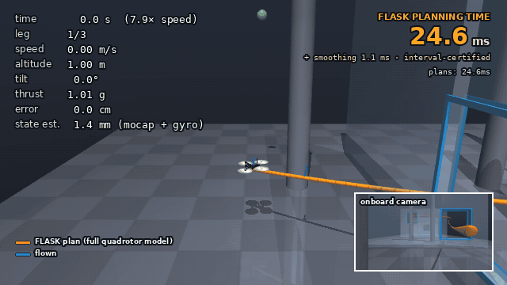
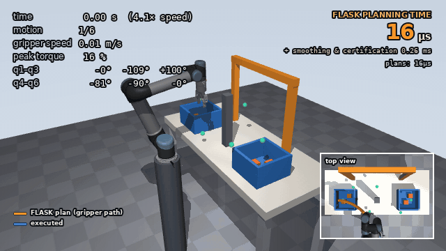
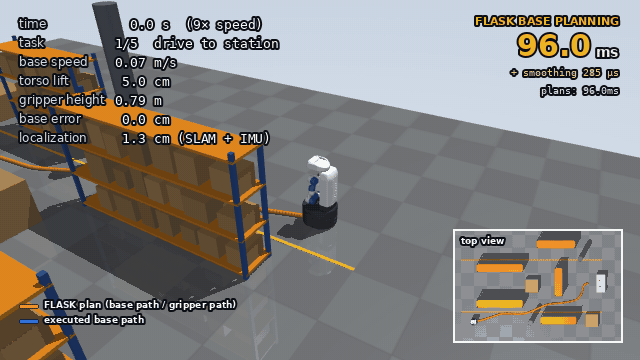

# TRO 2026 - Ultrafast Sampling-based Kinodynamic Planning via Differential Flatness (reproduced version)

<p align="left">


</p>

<p align="center"></p>
<p align="center"><em>FLASK on one CPU core in MuJoCo: Unitree G1 (base), Skydio X2 (full quadrotor model), UR5, Fetch.
Planning times are measured, and the controllers use only noisy onboard-style sensing.</em></p>

An unofficial, independent reproduction of **FLASK** from *Ultrafast Sampling-based Kinodynamic Planning via
Differential Flatness* (T. Duong, C. W. Ramsey, Z. Kingston, W. Thomason, L. E. Kavraki; IEEE T-RO 2026,
[arXiv:2603.16059](https://arxiv.org/abs/2603.16059), [project page](https://kavrakilab.org/flask/)).

FLASK plans kinodynamically feasible trajectories in the flat output space of differentially flat robots. It steers
with a closed-form minimum time/effort BVP and validates edges with SIMD collision checking (FLASKCC).

- **Planners.** FLASK-RRTConnect, BVP-SST\*, SIMD-SST\* and DP-RRT.
- **Validation.** Dense collision and limit checks on the original model, an interval-arithmetic certificate for full
  quadrotor models, and certified (Minkowski-inflated) planning.
- **Paper experiments.** Tables I and II and the UR5 experiments, with baselines (VAMP + TOPP-RA, Dynoplan SST and
  iDb-A\*, the authors' `ompl-flask`) and an evaluation protocol fixed before measuring.
- **MuJoCo showcases** on four robot types with sensor models.

## Contents
1. [Installation](#installation)
2. [Quick start](#quick-start)
3. [Reproduction results](#reproduction-results)
4. [MuJoCo showcases](#mujoco-showcases)
5. [Using FLASK on your robot](#using-flask-on-your-robot)
6. [Verification](#verification)
7. [Repository structure](#repository-structure)
8. [Limitations](#limitations)
9. [Citation](#citation)
10. [Acknowledgements and license](#acknowledgements-and-license)

## Installation

Tested on Ubuntu 22.04, Python 3.10, GCC 11.4, CMake 3.22, on x86-64 CPUs with AVX2 (Intel i9-14900 and
i5-1135G7). The native extension is compiled with `-march=native`, so build it on the machine that runs it.

```bash
sudo apt install build-essential cmake git python3.10-venv python3.10-dev libeigen3-dev
git clone <this repository> flask && cd flask
./install.sh                 # pinned VAMP + patch, .venv, native build, MotionBenchMaker data, tests (~10 min)
./install.sh --showcase      # optional: + MuJoCo showcase assets (Unitree G1 policy, Skydio X2) and CPU torch
source .venv/bin/activate
```

Third-party sources are fetched at pinned commits by `scripts/fetch_third_party.sh`. The baselines and the authors'
library are optional: `scripts/fetch_third_party.sh --all && scripts/setup_pc.sh`.

## Quick start

```python
import numpy as np
from flask_repro import mbm, native, robot

panda = robot.get_robot('panda')
problem = mbm.load_dataset('panda')['bookshelf_small'][0]            # a MotionBenchMaker problem
env = mbm.native_environment(problem)

settings = native.settings(range=1.0, velocity_sample_scale=0.0, dynamic_domain=True, prefix_steering=False)
result = native.plan(panda, env, problem['start'], problem['goals'], settings, seed=1)

traj = result['trajectory']                                           # C1 piecewise cubic within q/v/a limits
q, v, a = traj.evaluate(np.linspace(0, traj.duration(), 1000))[:3]
print(result['plan_ns'] / 1e3, 'us')
```

```bash
python examples/panda_quickstart.py                          # plan, dense check, certified variant
python examples/flat_quickstart.py quad3d_block rrt_connect   # unicycle_* / quad2d_* / quad3d_*, any of the 4 planners
```

## Reproduction results

All numbers come from controlled runs on held-out seeds. Timing uses one isolated P-core of an i9-14900, which is
about 2× faster than the paper's i7-6900K (k_hw = 0.467, measured with a VAMP calibration workload). Claims are
judged against criteria fixed before measuring (`config/claim_criteria_v10.json`):
- **Validity** is checked on the *original* model, and every attempt counts.
- **Time** must fall in a two-sided band of [1/3, 3] × k_hw × paper.

**Panda (paper Table II).** FLASK-RRTConnect matches the paper: 5/7 scenes fall inside the band, the other two are
faster, and 98.7% of the paths pass dense and URDF checks. The certified mode returned no invalid path.

<p align="center"></p>

**DynoBench (paper Table I).**
- **Quadrotors, r = 2** (the paper's reduced-order practice): RRTConnect is inside the band in 3/4 cases and faster
  in the fourth.
- **Quadrotors, r = 4** (full model): every path is certified feasible, and planning takes a few milliseconds.
- **Unicycle:** times are far from the paper's. The paper does not specify its velocity sampler (see
  [Limitations](#limitations)).

<p align="center"></p>
<p align="center"></p>

**Trajectories versus kinodynamic baselines.** FLASK returns smooth, dynamically feasible paths. SST explores with
short control rollouts, which leaves visible cusps (direction reversals).

<p align="center"></p>

**Tracking (paper Fig. 7 analogue).** In MuJoCo, a UR5 tracking FLASK trajectories has about 14× smaller worst-case
error than when it tracks time-scaled geometric paths.

<p align="center"></p>

Relative claims of the paper that hold here:
- **BVP vs propagation.** The BVP planners are faster than the propagation planners (6/6 cases).
- **SIMD validation.** It is 2.8–3.7× faster than scalar validation and returns the identical paths.
- **Determinism.** Repeated runs return identical paths, with timing within ±1.3%.

Regenerate the figures with `python -m benchmarks.readme_figures` (LaTeX sources of the tables are in
`docs/figures/`). Re-run the campaigns with:

```bash
python -m benchmarks.run_final_campaign --plan v10b --output results/paper_campaigns/<date>_v10b   # ~2 h, CPU from config/machine.json
python -m benchmarks.report_v10 --campaign results/paper_campaigns/<date>_v10b --table-i table_i_v10b \
    --table-ii table_ii_v10b_rest --seeds-i 6001-6030 --seeds-ii 6001-6010 \
    --calibration results/paper_campaigns/<date>_v10b/hardware_calibration.json --output <dir>
python -m experiments.ur5_mujoco --acceleration_feedforward True
```

## [MuJoCo showcases](https://drive.google.com/drive/folders/1tR735UjNGVpZDkEKdCtvVsk5S1-iuNps?usp=sharing)

| Unitree G1 | Skydio X2 | UR5 | Fetch |
|:-:|:-:|:-:|:-:|
|  |  |  |  |

| Robot | What FLASK plans | Planning time per motion | 10 seeds |
|---|---|---|---|
| Unitree G1 | base as a fully actuated point (r = 2); Unitree's walking policy tracks it | 34–610 µs | 10/10, no contact, no fall |
| Skydio X2 | full quadrotor model (r = 4), every edge interval-certified | 0.05–71 ms | 10/10, no contact |
| UR5 + Robotiq | 6-DoF arm, then lazy certification | 16–350 µs (+0.2–1.5 ms certification) | 10/10, no contact |
| Fetch | arm (torso + 7 DoF); diff-drive base (unicycle) | arm 13–650 µs; base 4–420 ms | 10/10, no contact |

**No privileged state in the loop.** Planning and control read only noisy sensor models
(`simulation/showcase/sensors.py`):
- **G1:** IMU, AHRS attitude, joint encoders, and SLAM-like localization at 30 Hz with 40 ms latency.
- **Drone:** motion capture plus gyro, with velocity estimated by a filter.
- **Fetch:** localization plus gyro for the base, encoders for the arm.

Ground truth is used only to score runs. Robot radii are derived from the simulated collision geometry and
checked by tests. Showcase-specific choices are listed in [`showcase/showcase_1/README.md`](showcase/showcase_1/README.md):
the drone's `rho`, G1 time scaling, and playback speed-ups.

```bash
python -m simulation.showcase.g1_courtyard --seed 1 --output out/g1     # also drone_hall, ur5_cell, fetch_warehouse
python -m simulation.showcase.select_runs --seeds 10                     # 10 seeds; median run -> showcase/showcase_1
python -m simulation.showcase.media                                      # 4K/1080p videos, 4K ghost stills, GIFs, 2x2
```

Ghost stills (4K) are in `showcase/showcase_1/stills/`. The videos (4K and 1080p, plus a 2×2 montage) are produced
by the last command; they are not stored in git because of their size.

## Using FLASK on your robot

| System | Entry point | Notes |
|---|---|---|
| Manipulator with a VAMP model (Panda, UR5, Fetch, ...) | `native.plan(robot, env, start, goals, settings)` | Default edge validation is the authors' peak-speed count. Use `native.plan_lazy_certified` for a hard collision guarantee |
| Omnidirectional base (legged or holonomic) | `native.plan` with `robot.get_robot('sphere')` and `set_radius(r)` | Point model, r = 2 |
| Quadrotor | `planning.plan(Quad3D(), World(...), start, goal, PlannerSettings(algorithm='rrt_connect'))` | Use the full model (r = 4). Plan against exact boxes (`World` directly). Check returned paths with `interval_validation.audit_segment` |
| Diff-drive base | `planning.plan(Unicycle(...), ..., algorithm='sst_bvp')` | Correct, but the slowest case (tens to hundreds of ms) |

Practical rules taken from the showcases:
- **Radius:** set it from the robot's real collision extent plus your tracking and localization error.
- **Start state:** plan from the last commanded goal and let feedback absorb the offset.
- **Timing:** time-scale a plan uniformly when the tracker needs headroom.

## Verification

| Check | Result |
|---|---|
| Mathematics: BVP optimality, T\*, Eq. 29, flatness map vs integrating the original dynamics | 10 000 cases each, max error 1e-9 |
| Authors' code (`ompl-flask`): steering on 10 001 boundaries, decisions on 7 831 edges | cost within 1.4e-15; identical decisions |
| 1 000 new random problems (Panda, unicycle, quadrotors) | 0 colliding or infeasible paths, 0 crashes |
| Probabilistic completeness: solve rate vs budget | BVP planners 100%; order-4 propagation 87–98% at 600 s |
| Test suite (`pytest -q tests`) | 500 tests, with negative controls for every validator |

The scripts are in `verification/` and their outputs in `results/verification/2026-11-25_acceptance/`.

## Repository structure

```
src/flask/            native C++: LQMT steering, FLASKCC, flat-system and manipulator planners
src/bindings.cc       nanobind module flask_repro._core (panda, ur5, fetch, sphere, flat planners)
flask_repro/          Python API: native.py, planning.py, flat models, interval validation, oracles
benchmarks/           paper campaigns, baselines, reports, README figures
experiments/          UR5 MuJoCo tracking and reactive experiments
simulation/showcase/  MuJoCo showcases, sensor models, renderers
verification/         first-principles, author-code and random-problem checks
config/ data/ tests/  planner profiles and seeds, MotionBenchMaker data, test suite
showcase/showcase_1/  showcase results: selection, per-run summaries, stills, GIFs
results/              summaries of the campaigns behind every table and figure
```

## Limitations

- **Unofficial.** The unreleased parts follow the paper text. Parameters the paper does not state were chosen on
  development seeds, by rules written before running; they are recorded in `config/*.json`.
- **Unicycle and propagation variants do not reach the paper's speed.**
  - On the unicycle, 96–98% of BVP edges violate |ω| ≤ 1.5, and the paper does not specify its velocity sampler.
  - For the propagation planners, the paper does not specify the flat order or the horizon.
  - Order-4 RRTConnect on quadrotors is 3–16× slower than the paper's order-2 numbers, but feasible for the full
    model.
- **BVP-SST\* anytime output.** The search cost decreases monotonically, but after the greedy Alg. 4 shortcut the
  returned cost is non-monotone in 27/60 runs.
- **Simulation only.** Nothing here has run on a physical robot. The obstacle map is assumed known, as in the paper.

## Citation

Please cite the original paper:

```bibtex
@article{duong2026flask,
  title   = {Ultrafast Sampling-based Kinodynamic Planning via Differential Flatness},
  author  = {Duong, Thai and Ramsey, Clayton W. and Kingston, Zachary and Thomason, Wil and Kavraki, Lydia E.},
  journal = {IEEE Transactions on Robotics},
  year    = {2026},
  note    = {arXiv:2603.16059}
}
```

## Acknowledgements and license

This work builds on [VAMP](https://github.com/KavrakiLab/vamp), [ompl-flask](https://github.com/KavrakiLab/ompl-flask),
[MotionBenchMaker](https://github.com/KavrakiLab/motionbenchmaker), [DynoBench/Dynoplan](https://github.com/quimortiz/dynoplan),
[TOPP-RA](https://github.com/hungpham2511/toppra) and [MuJoCo](https://github.com/google-deepmind/mujoco).

The showcases use the following, all fetched at pinned commits and not redistributed:
- [unitree_rl_gym](https://github.com/unitreerobotics/unitree_rl_gym): G1 model and walking policy (BSD-3-Clause);
- [MuJoCo Menagerie](https://github.com/google-deepmind/mujoco_menagerie): Skydio X2;
- the Fetch and UR5 models shipped with VAMP. Their COLLADA meshes are cached as OBJ in `assets/converted_meshes`.

Third-party code keeps its own license. The code of this repository is released under the
[BSD 3-Clause License](LICENSE).
