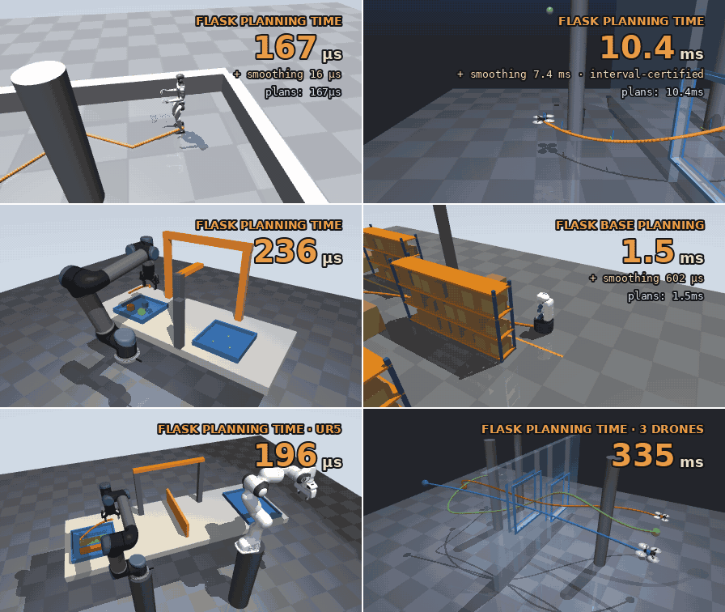
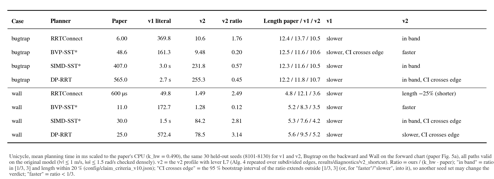
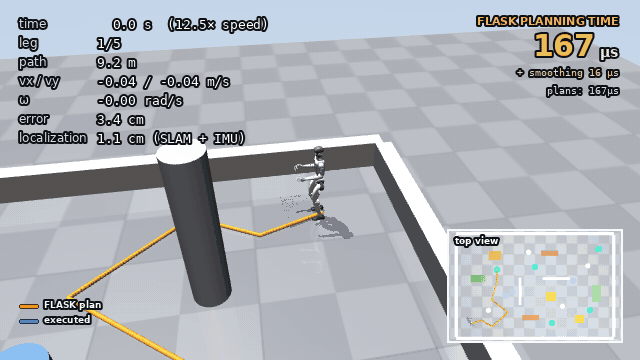
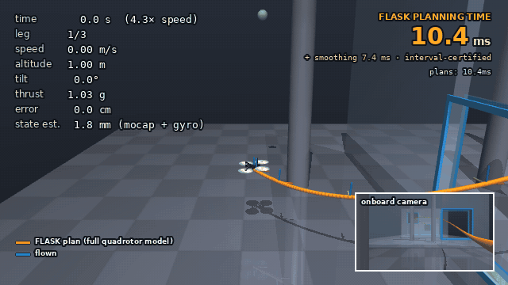
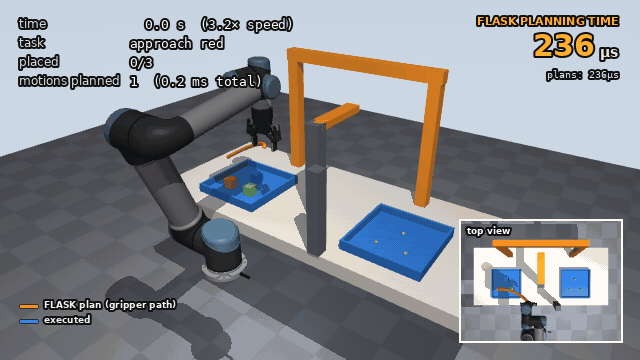
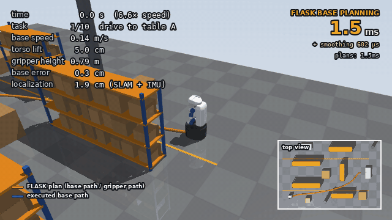
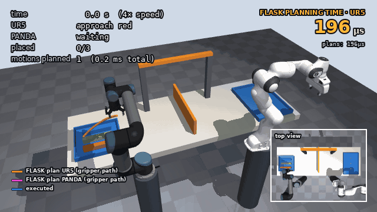
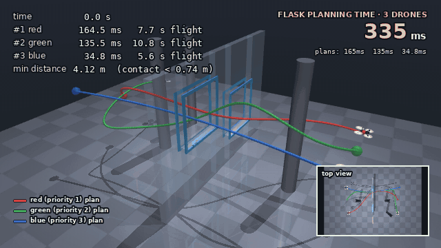

# 2026 TRO - Ultrafast Sampling-based Kinodynamic Planning via Differential Flatness (reproduced ver)

<p align="left">


</p>

<p align="center"></p>
<p align="center"><em>FLASK on one CPU core in MuJoCo: Unitree G1 and Skydio X2 (full quadrotor model); UR5 and Fetch
pick-and-place; UR5 + Panda hand-over and three quadrotors sharing two windows (multi-robot). Planning times are
measured; controllers use only noisy onboard-style sensing; playback is sped up.</em></p>

An unofficial, independent reproduction of **FLASK** from *Ultrafast Sampling-based Kinodynamic Planning via
Differential Flatness* (T. Duong, C. W. Ramsey, Z. Kingston, W. Thomason, L. E. Kavraki; IEEE T-RO 2026,
[arXiv:2603.16059](https://arxiv.org/abs/2603.16059), [project page](https://kavrakilab.org/flask/)).

FLASK plans kinodynamically feasible trajectories in the flat output space of differentially flat robots. It steers
with a closed-form minimum time/effort BVP and validates edges with SIMD collision checking (FLASKCC). The authors'
flat-planning code is in [OMPL](https://github.com/ompl/ompl) (commit `e288901`, identical to the version checked
here). This repository adds the unicycle, the propagation planners, independent validators, the paper's experiments
and multi-robot showcases.

- **Planners** (C++ with Python bindings): FLASK-RRTConnect, BVP-SST\*, SIMD-SST\* and DP-RRT, for manipulators
  (Panda, UR5, Fetch), point bases, the unicycle and 2D/3D quadrotors.
- **Validation:** dense checks on the original model, interval certificates for full quadrotor models, and certified
  manipulator planning.
- **Paper experiments:** Tables I and II and the UR5 tracking experiment, on held-out seeds, with criteria fixed
  before measuring.
- **Demos:** six MuJoCo scenes, including pick-and-place and two multi-robot teams.

**v2.** Read literally, the paper left every unicycle row 3–200× slower than published. v2 fills the unspecified
parts with options chosen on development seeds by rules written before the runs. On held-out seeds, 7 of 8 unicycle
rows are inside the paper's time band or faster. All options are off by default. Details:
[REPRODUCTION.md](REPRODUCTION.md), [CHANGELOG](CHANGELOG.md).

## Installation

Tested on Ubuntu 22.04, Python 3.10, GCC 11.4, CMake 3.22, on x86-64 CPUs with AVX2 (Intel i9-14900 and
i5-1135G7). The native extension is compiled with `-march=native`, so build it on the machine that runs it.

```bash
sudo apt install build-essential cmake git python3.10-venv python3.10-dev libeigen3-dev
git clone <this repository> flask && cd flask
./install.sh                 # pinned VAMP + patch, .venv, native build, MotionBenchMaker data, tests (~10 min)
./install.sh --showcase      # optional: + showcase assets (G1 policy, Menagerie X2 / 2F-85 / Panda), CPU torch
source .venv/bin/activate
```

Third-party sources are fetched at pinned commits by `scripts/fetch_third_party.sh`. The baselines and the authors'
library are optional: `scripts/fetch_third_party.sh --all && scripts/setup_pc.sh`.

## Quick start

```python
import numpy as np
from flask_repro import mbm, native, robot

panda = robot.get_robot('panda')
problem = mbm.load_dataset('panda')['bookshelf_small'][0]            # a MotionBenchMaker problem
env = mbm.native_environment(problem)
settings = native.settings(range=1.0, velocity_sample_scale=0.0, dynamic_domain=True, prefix_steering=False)
result = native.plan(panda, env, problem['start'], problem['goals'], settings, seed=1)
traj = result['trajectory']                                           # C1 piecewise cubic within q/v/a limits
print(result['plan_ns'] / 1e3, 'us', traj.duration(), 's')
```

```python
from flask_repro.planning import plan, validate
from flask_repro.profiles import load_profile

s = load_profile('unicycle_wall', 'rrt_connect')       # DynoBench problem + the settings behind the tables
r = plan(s.model, s.planning, s.start, s.goal, s.settings, seed=1)
print(r.solved, validate(r, s.model, s.original, s.settings)['valid'], r.plan_ns / 1e6, 'ms')
```

```bash
python examples/panda_quickstart.py                            # plan, dense check, certified variant
python examples/flat_quickstart.py unicycle_wall rrt_connect    # unicycle_* / quad2d_* / quad3d_*, any of the 4 planners
```

## Results

Measured on held-out seeds, on one P-core of an i9-14900 (about 2× faster than the paper's i7-6900K; the factor
k_hw is measured in each campaign). A row reproduces the paper if every path is valid on the original model and
the time is within [1/3, 3] × k_hw × paper (`config/claim_criteria_v10.json`).

**Panda (Table II).** 5 of 7 scenes are inside the band and the other 2 are faster. In the certified mode, 0 paths
were invalid.

<p align="center"></p>

**DynoBench (Table I).**
- **Unicycle:** all 240 paths are valid. 4 rows are inside the band in time and length, 2 are faster (BVP-SST\*),
  1 has paths 25 % shorter than the paper's, and 1 is just above the band (3.14).
- **Quadrotors, r = 2** (the paper's practice): 3 of 4 cases are inside the band.
- **Quadrotors, r = 4** (full model): all 431 paths are interval-certified; RRTConnect is 5–10× slower than the
  paper's r = 2 numbers.

<p align="center"></p>
<p align="center"></p>
<p align="center"></p>

The full tables, stability across seed sets, the generalization check, the UR5 tracking figure and the
commands to re-run every campaign are in [REPRODUCTION.md](REPRODUCTION.md).

## [MuJoCo showcases](https://drive.google.com/drive/folders/1tR735UjNGVpZDkEKdCtvVsk5S1-iuNps?usp=sharing)

| Unitree G1 | Skydio X2 |
|:-:|:-:|
|  |  |
| **UR5 pick-and-place** | **Fetch pick-and-place** |
|  |  |
| **UR5 + Panda hand-over** | **Three quadrotors** |
|  |  |

| Scene | What FLASK plans | Planning time per motion | 10 seeds |
|---|---|---|---|
| UR5 + Robotiq 2F-85 | 3 cubes, tray A → B through clutter; every motion planned online, the held cube in the collision model | 0.05–5.9 ms | 10/10: all placed, no contact |
| Fetch | carton from table A to table B: base (unicycle, BVP-SST\*) and arm (torso + 7 DoF) | base 0.07–25 ms; arm 0.01–1.6 ms | 10/10: placed within 11 mm, no contact |
| UR5 + Franka Panda | 3 bars handed over mid-air; prioritized space-time planning between the arms | 0.06–39 ms | 10/10: all placed, arms ≥ 4.1 cm apart |
| 3 × Skydio X2 | cross a hall through two windows, two head-on; full model (r = 4), prioritized space-time planning with exact polynomial clearance | 3–374 ms per drone | 10/10: interval-certified, no contact |
| Skydio X2 | three legs through windowed walls, full model (r = 4), every edge interval-certified | 0.06–128 ms | 10/10: no contact |
| Unitree G1 | base as a fully actuated point (r = 2); Unitree's walking policy tracks it | 0.04–9.8 ms | 10/10: no contact, no fall |

**Multi-robot planning.** Both teams use prioritized planning: robots plan one at a time, and each avoids the
motions already committed by the others on a common clock.
- **Drones:** each avoids the higher-priority drones' polynomial trajectories exactly
  (`PlannerSettings.moving_obstacles`), planned with a single forward FLASK tree (`algorithm='rrt_forward'`), whose
  nodes carry absolute time.
- **Arms:** each avoids the other arm's swept VAMP spheres, and waits when that motion blocks its goal.

Both are additions beyond the paper. They are off by default, and with them off, results are bit-identical to before.

**Grasping.** The fingers close on the object by contact. Once the finger encoders report a stall, a MuJoCo weld
holds the object (a disclosed simulation aid). While the object is held, it is part of the planner's collision
model (`Environment.attach`). The UR5 uses the actuated Menagerie Robotiq 2F-85 in simulation. The planner keeps
VAMP's UR5 + Robotiq 85 sphere model, and a test checks that the 2F-85 stays inside it. The robot is a UR5, not a
UR5e.

**No privileged state in the loop.** Planning and control read only noisy sensor models
(`simulation/showcase/sensors.py`):
- arms: joint encoders;
- Fetch: SLAM-like pose and gyro, plus head-camera detections of the carton and the place marker;
- drones: motion capture and gyro;
- G1: IMU, AHRS, encoders and SLAM-like pose.

Ground truth is used only to score runs and to anchor the weld. All showcases use the v2 planner profiles.
Showcase-specific choices are listed in [`showcase/showcase_2/README.md`](showcase/showcase_2/README.md): `rho` per
robot, padding, the Fetch carry footprint, G1 time scaling and playback speed-ups.

```bash
export FLASK_SHOWCASE=showcase_2
python -m simulation.showcase.ur5_pickplace --seed 3 --output out/ur5      # also fetch_pickplace, multiarm_handover,
                                                                          # multidrone_swap, drone_hall, g1_courtyard
python -m simulation.showcase.select_runs --seeds 10                       # 10 seeds; median run -> showcase/showcase_2
python -m simulation.showcase.media                                        # 4K/1080p videos, 4K stills, GIFs, 3x2
```

Ghost stills (4K) are in `showcase/showcase_2/stills/`. The videos (4K and 1080p, plus the 3×2 montage) are
produced by the last command; they are not stored in git because of their size. The first showcase (v1 settings,
no grasping) is in the git history.

## Using FLASK on your robot

| System | Entry point | Notes |
|---|---|---|
| Manipulator with a VAMP model (Panda, UR5, Fetch, ...) | `native.plan(robot, env, start, goals, settings)` | Default edge validation is the authors' peak-speed count, which can miss contacts: see the warning below. Use `native.plan_lazy_certified` for a hard collision guarantee |
| Omnidirectional base (legged or holonomic) | `native.plan` with `robot.get_robot('sphere')` and `set_radius(r)` | Point model, r = 2 |
| Quadrotor | `planning.plan(Quad3D(), World(...), start, goal, PlannerSettings(algorithm='rrt_connect'))` | Use the full model (r = 4). Plan against exact boxes (`World` directly). Check returned paths with `interval_validation.audit_segment` |
| Diff-drive base | `planning.plan(Unicycle(reverse=...), ..., PlannerSettings(algorithm='rrt_connect', parent_candidates=5, duration_multipliers=(1.5, 2., 3.), shortcut_subdivisions=4, shortcut_rounds=3))` | 0.7–5 ms on the DynoBench maps (`profiles.load_profile` shows the full settings, `config/low_dof_v2d_order2.json`). One plan drives in one direction, set by `reverse`: see below |
| Held object, several robots | `env.attach(spheres)` before planning; `PlannerSettings(algorithm='rrt_forward', moving_obstacles=moving_pieces(other.trajectory, radius))` | The attached spheres are checked like the robot. Flat robots avoid other robots' trajectories on a common clock (`simulation/showcase/manip.py`, `multidrone_swap.py`) |

**Warning: default manipulator validation is not collision-free.** `native.plan` checks each edge at the
resolution the paper uses (peak-speed count). On the Panda Table II problems, 92 of 6 990 returned paths (1.3%)
touch an obstacle in a dense 1 kHz check (campaign v10b). The contact lasts a median of 20 ms (max 65 ms), and the
deepest sampled penetration is 2.1 mm (`results/diagnostics/panda_default_contacts/`). The certified
mode `native.plan_lazy_certified` plans against obstacles inflated by 2 mm and re-checks the returned path. It
returned 0 invalid paths in 6 950 solved problems, at a median of 0.73 ms instead of 0.18 ms (campaign v10). Use it
whenever contact matters.

**Invalid inputs fail fast.** A start or goal that is out of bounds or in collision returns at once with
`reason='invalid_start'` or `'invalid_goal'`. For flat systems this is checked against the exact obstacles. It does
not spend the time budget. NaN or inf states raise `ValueError`.

**Driving direction (diff-drive).** One plan drives either forward or backward (κ in Eq. 10) for its whole
length. A direction change needs a stop, where the flatness map is singular. Pick the direction that suits the
start and goal headings: on the DynoBench maps, Wall is forward and Bugtrap backward. If your robot may reverse and
you do not know in advance, plan once per direction and keep the shorter path.

Practical rules taken from the showcases:
- **Radius:** set it from the robot's real collision extent plus your tracking and localization error.
- **Start state:** plan from the last commanded goal and let feedback absorb the offset.
- **Timing:** time-scale a plan uniformly when the tracker needs headroom.

## Status

A research tool for planning in simulation, with the evidence in this repository:
- **Validity:** no returned path was invalid on the unicycle (original model), on the full quadrotor model (interval
  certificate) or on 1 520 unseen problems.
- **Reproducibility:** repeated runs give identical paths, and the tests re-run the unicycle table from a clone.
- **Errors:** invalid inputs fail at once with a reason.
- **Tests:** 568 tests, with negative controls (`pytest -q tests`); CI in `.github/workflows/tests.yml`.

Not yet checked:
- other CPUs: everything was measured on one desktop, and the extension needs AVX2 (`-march=native`);
- physical robots;
- API stability across versions.

The default manipulator validation can leave millimetre contacts (above). The full list of limitations is in
[REPRODUCTION.md](REPRODUCTION.md#limitations-full-list).

## Repository structure

```
src/flask/            native C++: LQMT steering, FLASKCC, flat-system and manipulator planners
src/bindings.cc       nanobind module flask_repro._core (panda, ur5, fetch, sphere, flat planners)
flask_repro/          Python API: native.py, planning.py, flat models, interval validation, oracles
benchmarks/           paper campaigns, baselines, reports, README figures
experiments/          UR5 MuJoCo tracking and reactive experiments
simulation/showcase/  MuJoCo showcases, sensor models, renderers
verification/         first-principles, author-code and random-problem checks
config/ data/ tests/  planner profiles and seeds, MotionBenchMaker data, test suite
showcase/showcase_2/  showcase results: selection, per-run summaries, stills, GIFs
results/              summaries of the campaigns behind every table and figure
REPRODUCTION.md       full results, v2 changes, verification, limitations, re-run commands
```

## Citation

Please cite the original paper:

```bibtex
@article{duong2026flask,
  title   = {Ultrafast Sampling-based Kinodynamic Planning via Differential Flatness},
  author  = {Duong, Thai and Ramsey, Clayton W. and Kingston, Zachary and Thomason, Wil and Kavraki, Lydia E.},
  journal = {IEEE Transactions on Robotics},
  year    = {2026},
  note    = {arXiv:2603.16059}
}
```

## Acknowledgements and license

This work builds on [VAMP](https://github.com/KavrakiLab/vamp), [ompl-flask](https://github.com/KavrakiLab/ompl-flask) (now in [OMPL](https://github.com/ompl/ompl)),
[MotionBenchMaker](https://github.com/KavrakiLab/motionbenchmaker), [DynoBench/Dynoplan](https://github.com/quimortiz/dynoplan),
[TOPP-RA](https://github.com/hungpham2511/toppra) and [MuJoCo](https://github.com/google-deepmind/mujoco).

The showcases use the following, all fetched at pinned commits and not redistributed:
- [unitree_rl_gym](https://github.com/unitreerobotics/unitree_rl_gym): G1 model and walking policy (BSD-3-Clause);
- [MuJoCo Menagerie](https://github.com/google-deepmind/mujoco_menagerie): Skydio X2, Robotiq 2F-85, Franka Panda;
- the Fetch and UR5 models shipped with VAMP. Their COLLADA meshes are cached as OBJ in `assets/converted_meshes`.

Third-party code keeps its own license. The code of this repository is released under the
[BSD 3-Clause License](LICENSE).
