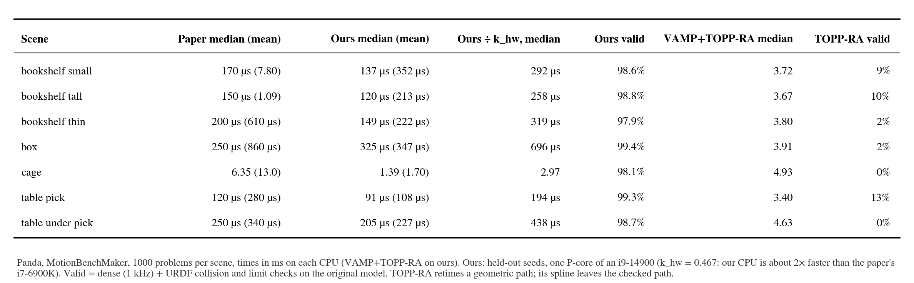
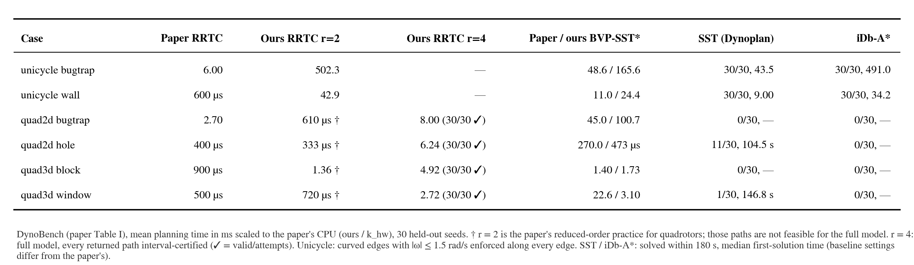
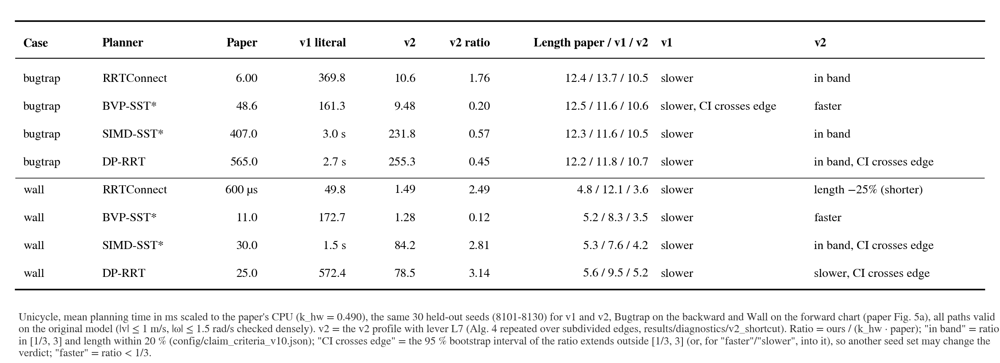
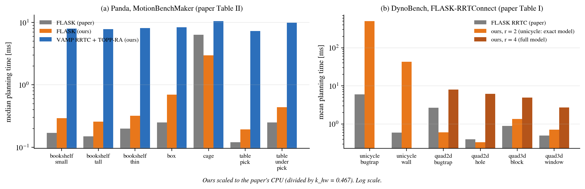
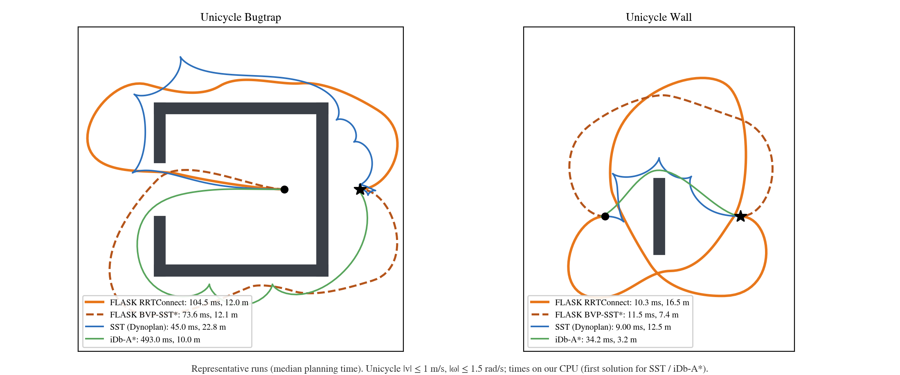
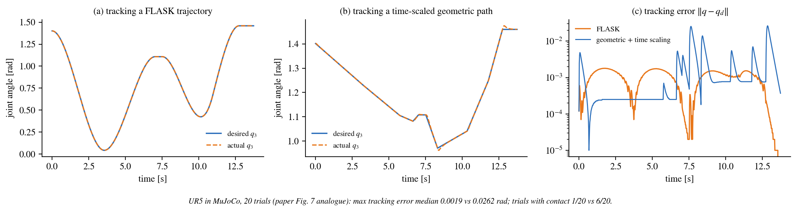
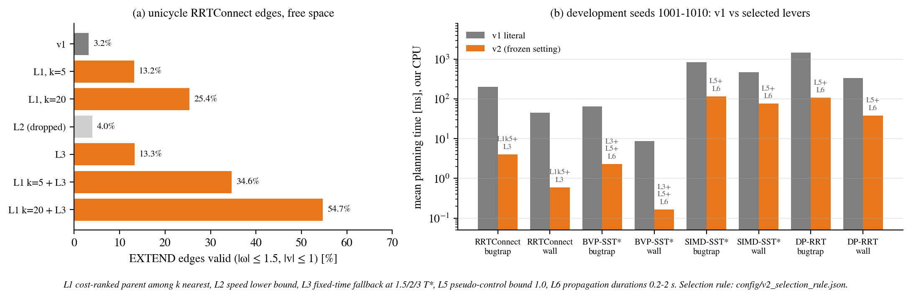

# Reproduction details

The full results behind the [README](README.md): every table and figure, what v2 changes and why, the checks, and
the commands to re-run the campaigns.

## Results

All numbers come from controlled runs on held-out seeds. Timing uses one isolated P-core of an i9-14900, which is
about 2× faster than the paper's i7-6900K. The factor k_hw is measured with a VAMP calibration workload in each
campaign: 0.467 for Table II (campaign v10b) and 0.490 for Table I (campaign v2d,
`results/paper_campaigns/2026-11-28_final_v2d`, which measures every Table I row with the released code). Claims are
judged against criteria fixed before measuring (`config/claim_criteria_v10.json`):
- **Validity** is checked on the *original* model, and every attempt counts.
- **Time** must fall in a two-sided band of [1/3, 3] × k_hw × paper.

**Panda (paper Table II).** FLASK-RRTConnect matches the paper: 5/7 scenes fall inside the band, the other two are
faster, and 98.7% of the paths pass dense and URDF checks. The certified mode returned no invalid path.

<p align="center"></p>

**DynoBench (paper Table I)**, 30 new held-out seeds per row (8101–8130, never used before, one campaign):
- **Unicycle (v2):** every path (240/240) is valid on the original model.
  - Two rows are inside the band in time and length with their whole 95% interval, both on bugtrap: RRTConnect
    (ratio 1.76 [1.50, 2.03]) and SIMD-SST\* (0.57 [0.42, 0.73]).
  - Two more are inside the band, but their interval crosses an edge, so another seed set may fall outside:
    DP-RRT on bugtrap (0.45 [0.32, 0.59]) and SIMD-SST\* on wall (2.81 [1.89, 3.84]).
  - BVP-SST\* is 5–8× *faster* than the paper. By our criteria that is a difference, not a reproduction.
  - RRTConnect on wall is inside the band in time (2.49), but its paths are 25% *shorter* than the paper's
    (3.6 vs 4.8 m). The length criterion is two-sided, so this counts as a difference.
  - DP-RRT on wall is just above the band (3.14 [2.01, 4.48]). On the previous seed set (8001–8030, without L7) it
    was 2.53. L7 takes 4.5% of its time, so most of the change is the seeds.
- **Quadrotors, r = 2** (the paper's reduced-order practice): RRTConnect is inside the band in 3/4 cases and faster
  in the fourth.
- **Quadrotors, r = 4** (full model): every returned path is certified feasible by interval arithmetic (431/431),
  and RRTConnect plans in a few milliseconds, 5–10× slower than the paper's r = 2 numbers.

<p align="center"></p>

**Unicycle: v1 literal and v2 on the same seeds** (8101–8130, same driving direction for both). v1 is the paper
read literally: uniform velocity sampling, nearest parent by metric, T\* only, one Alg. 4 pass, and our earlier
propagation defaults.

| Variant | v1 literal → v2 (paper CPU) | Paper | Verdict v1 → v2 |
|---|---|---|---|
| RRTConnect, bugtrap / wall | 370 / 50 ms → 10.6 / 1.49 ms | 6.0 / 0.60 ms | slower → **in band** / time in band, path 25% shorter |
| BVP-SST\*, bugtrap / wall | 161 / 173 ms → 9.5 / 1.28 ms | 48.6 / 11 ms | slower → faster |
| SIMD-SST\*, bugtrap / wall | 3.0 / 1.5 s → 232 / 84 ms | 407 / 30 ms | slower → **in band** / in band (interval crosses 3) |
| DP-RRT, bugtrap / wall | 2.7 s / 572 ms → 255 / 79 ms | 565 / 25 ms | slower → in band (interval crosses 1/3) / slower (3.14, interval reaches into the band) |

<p align="center"></p>

**Stability across seed sets.** Bugtrap used the same v2 search in three held-out campaigns, so we can compare
three independent sets of 30 seeds. The last one adds L7, which shortens the path after the search. The time
ratio is ours / (k_hw · paper), with 95% bootstrap intervals.

| Bugtrap | Seeds 7001–7030 (`final_v2`) | Seeds 8001–8030 (`final_v2c`) | Seeds 8101–8130 (`final_v2d`, + L7) | Length (m) |
|---|---|---|---|---|
| RRTConnect | 1.39 [1.19, 1.59] | 1.57 [1.33, 1.81] | 1.76 [1.50, 2.03] | 11.9 / 11.9 / 10.5 |
| BVP-SST\* | 0.19 [0.13, 0.25] | 0.19 [0.15, 0.24] | 0.20 [0.15, 0.24] | 11.6 / 11.6 / 10.6 |
| SIMD-SST\* | 0.50 [0.34, 0.69] | 0.62 [0.44, 0.82] | 0.57 [0.42, 0.73] | 11.5 / 11.7 / 10.5 |
| DP-RRT | 0.47 [0.32, 0.64] | 0.34 [0.24, 0.48] | 0.45 [0.32, 0.59] | 13.0 / 12.0 / 10.7 |

The intervals overlap on every row. DP-RRT sits near the lower edge of the band (1/3), so its verdict flips
between "in band" and "faster" from one seed set to another. On Wall, DP-RRT does the same at the upper edge
(2.53 on 8001–8030, 3.14 on 8101–8130).

**Generalization: problems never used to choose a setting.** The v2 options were chosen on Bugtrap and Wall, so
we also ran v1 and v2 on unicycle problems that played no part in any choice:
- 3 more DynoBench maps (kink, kink_v1, parallelpark) × 30 seeds;
- 100 random box scenes.

Each problem was run in both driving directions with all four planners and a 10 s budget. Every returned path was
checked on the original model. The pass rule was written before the run (`config/v2_generalization_rule.json`):
- G1: v2 returns no invalid path and never crashes;
- G2: v2 solves at least as many problems as v1, minus a small allowance;
- G3: v2 has the lower median time in at least 80% of cells.

| | Solved | Invalid paths returned | Faster median time |
|---|---|---|---|
| v1 literal | 1348/1520 (parallelpark backward RRTConnect: 0/30) | 0 | 0 of 32 cells |
| v2 (with L7) | **1520/1520** | **0** | **32 of 32 cells** (median speed-up 21×, range 2–1590×) |

Verdict: **GENERALIZES** (`results/diagnostics/v2_generalization_v2d/RESULT.md`; the same check without L7,
`v2_generalization_release`, gave the same verdict). v2 is not better everywhere. On parallelpark backward, its
paths are 14–26% longer than v1's on the problems both solve. The budget is wall-clock, so v1's solved count can
move by a few attempts between runs (1350 before, 1348 here).

This check also found a bug. Its first run (`results/diagnostics/v2_generalization/`) caught two v1 paths that
left the workspace by 6 and 15 µm. Workspace bounds had been checked at sampled points with 1e-5 m slack. They are
now checked exactly at each polynomial's extrema (`exact_bounds`, on by default), and the rerun above, with the
released binary, has none. We then re-measured all of Table I with the released binary (campaign `final_v2c`).
The unicycle attempts came out identical, and 49 of 480 order-4 quadrotor attempts changed. No attempt changed
between solved and unsolved.
<p align="center"></p>

**Trajectories versus kinodynamic baselines.** FLASK returns smooth, dynamically feasible paths. SST explores with
short control rollouts, which leaves visible cusps (direction reversals). On the wall, the v2 paths go over the
wall, as in the paper's Fig. 5a. The v1 literal path circles the whole map.

<p align="center"></p>

**Tracking (paper Fig. 7 analogue).** In MuJoCo, a UR5 tracking FLASK trajectories has about 14× smaller worst-case
error than when it tracks time-scaled geometric paths.

<p align="center"></p>

Relative claims of the paper that hold here:
- **BVP vs propagation.** The BVP planners are faster than the propagation planners (6/6 cases).
- **SIMD validation.** It is 2.8–3.7× faster than scalar validation and returns the identical paths.
- **Determinism.** Repeated runs return identical paths, with timing within ±1.3%.

## What v2 changes and why

The paper fixes the steering function (the LQMT BVP) and the planners. It does not say how the unicycle's velocity
is sampled, which node is extended, or how long propagation steps are. In v1 we read these literally.

**The cause in v1.** 96–98% of BVP edges were rejected for violating |ω| ≤ 1.5 rad/s. The flatness map gives
ω = (ẋÿ − ẍẏ)/(ẋ² + ẏ²). An edge between two states whose velocities point in different directions has to turn
hard, often at low speed, so ω blows up. A mechanism study on the planner's own trees in free space measured each
candidate change (`results/diagnostics/v2_mechanism/RESULT.md`). A change was kept only if it at least doubled the
share of valid edges.

| Option (setting) | What it does | Why | Measured effect |
|---|---|---|---|
| **L1** `parent_candidates = k` | among the k metric-nearest nodes, extend from the one with the lowest LQMT cost C(T\*) (Eq. 24) | a cheap edge needs little acceleration, hence little turning; the sample is still drawn independently of the tree | valid edges 3.2% → 13% (k = 5), 25% (k = 20) |
| **L3** `duration_multipliers = (1.5, 2, 3)` | when the T\* edge violates a *dynamic* limit (not a collision), retry with the paper's fixed-time BVP (Example 4) at 1.5, 2 and 3 × T\*; also used inside the Alg. 4 shortcut | a slower edge turns more gently; the closed-form fixed-time solution is already in the paper | 3.2% → 13%; with L1 (k = 20) 55% |
| **L5** `control_bound = 1.0` | pseudo-control bound of the propagation planners | fewer propagated states leave the limits | accepted propagations 37% → 83% |
| **L6** `propagation_min/max = 0.2/2.0 s` | propagation durations | the defaults of the baseline library (Dynoplan) for the same robot | (selected by the factorial) |
| L2 `speed_min` (dropped) | keep sampled speeds away from 0, where ω is singular | | ≤ 1.25×, below the threshold |

Next, a factorial over these options ran on development seeds 1001–1010. One setting per planner was frozen by
`config/v2_selection_rule.json`:
- all 10 attempts valid on the original model;
- then the lowest mean time;
- then the fewest options;
- never by closeness to the paper.

The selected settings were:

| Planner | Selected options |
|---|---|
| RRTConnect | L1 (k = 5) + L3 |
| BVP-SST\* | L3 + L5 + L6 |
| SIMD-SST\* and DP-RRT | L5 + L6 |

They are recorded in `config/low_dof_v2_order2.json`. The table above then measures them on new seeds.

**Driving direction on the Wall map.** The flatness map of Eq. 10 has a sign κ: the unicycle drives forward
(κ = 0) or backward (κ = 1). The paper does not say which it used, and v1 drove backward on both maps (chosen on
development seeds). On the Wall map this forces a loop. Start and goal both face +x with the goal straight ahead, so
a backward-driving robot must back away and circle round to arrive. The paper's Fig. 5a settles it: the drawn robot
poses trail the motion on Wall and lead it on Bugtrap. v2 therefore drives forward on Wall and backward on Bugtrap.

The robot is a single sphere (paper Sec. VII-A), so κ changes only the start and goal states. On development seeds
the forward chart shortened the Wall paths from 7.4 to 4.4 m (BVP-SST\*) and from 8.3 to 5.7 m (SIMD-SST\*)
(`results/diagnostics/v2_chart/`). We found this after measuring seeds 7001–7030, so the unicycle rows were
measured again on the fresh seeds 8001–8030 (`config/low_dof_v2b_order2.json`), with the options left unchanged.

For the order-4 quadrotors none of L1–L6 helped, so their search keeps the v1 setting. Their rejections are
collisions and workspace bounds, never dynamic limits.

**L7: Alg. 4 over subdivided edges (beyond the paper).** With the options above, Wall paths were still bimodal on
seeds 8001–8030: 9/30 RRTConnect paths were 3.3–3.7 m long, the rest 5.5–11.7 m. After Alg. 4 every path had only
2–5 edges, so the length came from *where* the remaining nodes were. RRTConnect returns its first solution, and
Alg. 4 (paper p. 10) only tries to connect states at the knots of the path. With two edges through a far node, the
only bypass it can try is start→goal, which collides, so the detour stays (`results/diagnostics/v2_shortcut/`).

L7 adds rounds after the paper's single pass. Each round:
1. splits every edge at m − 1 interior times (the polynomial restricted to a sub-interval is the Hermite polynomial
   between its own end states, so the path does not change);
2. runs the same greedy shortcut over these finer states, with the same steering and the same validation;
3. accepts a bypass only if it lowers the LQMT cost of what it replaces.

The search itself is untouched: the same seed grows the same tree. The settings (`shortcut_subdivisions` m,
`shortcut_rounds`) were chosen on development seeds 1101–1130 by `config/v2_shortcut_rule.json`, written before
the runs: every path valid, mean time at most 1.5× that of the paper's pass alone, then the shortest paths, which
had to be at least 5% shorter. The paper's numbers played no part.

| Planner | Selected m × rounds | Paths vs. the paper's pass alone (dev seeds) |
|---|---|---|
| unicycle RRTConnect, BVP-SST\* | 4 × 3 | 27% / 20% shorter on average |
| unicycle SIMD-SST\*, DP-RRT | 8 × 4 | 20% / 22% shorter |
| quadrotor r = 4 RRTConnect / BVP-SST\* | 4 × 3 / 8 × 4 | 15% / 14% shorter |

On the held-out seeds 8101–8130, the same attempts with and without L7 give
(`results/diagnostics/v2_shortcut/heldout_paired/summary.json`):

| Unicycle | Mean length without → with L7 (m) | Longest path (m) | Share of time in post-processing |
|---|---|---|---|
| Wall RRTConnect | 6.43 → 3.63 | 12.0 → 5.6 | 42% |
| Wall BVP-SST\* | 5.22 → 3.55 | 9.3 → 5.1 | 36% |
| Wall SIMD-SST\* / DP-RRT | 5.75 → 4.23 / 7.78 → 5.18 | 10.3 → 8.7 / 15.4 → 7.8 | 3% / 4.5% |
| Bugtrap, all four planners | 11.7–12.2 → 10.5–10.7 | | 2.5–12% |

No path became longer, and every one stayed valid on the original model. The cost is time: on Wall, RRTConnect and
BVP-SST\* spend about 40% of their (sub-millisecond) time in post-processing. L7 is our addition. It is not in the
paper, and the paper's paths may not have been shortened this way; this is why some of our paths are now shorter
than the paper's. To get v2 without L7, pass `shortcut_subdivisions=1, shortcut_rounds=1`. Those settings give the
paper's single pass bit for bit, and they are the release campaign `final_v2c` (seeds 8001–8030), kept for
comparison.

<p align="center"></p>

Every option defaults to off. With all options off, v2 returns bit-identical paths to v1 (`tests/test_v2_levers.py`,
`tests/test_shortcut_l7.py`, `tests/test_profiles.py`).
Every v2 path is still judged by the same independent validator on the original model.

Regenerate the figures with `python -m benchmarks.readme_figures` (LaTeX sources of the tables are in
`docs/figures/`). Re-run the campaigns with:

```bash
python -m benchmarks.v2_factorial --output <dir>                                                    # v2 selection, dev seeds
python -m benchmarks.run_final_campaign --plan v2 --output results/paper_campaigns/<date>_v2       # Table I, v2 + v1 literal, ~1.5 h
python -m benchmarks.run_final_campaign --plan v2c --output results/paper_campaigns/<date>_v2c     # v2 without L7: all Table I rows, ~2 h
python -m benchmarks.v2_shortcut_factorial --output <dir>                                           # L7 selection, dev seeds 1101-1130, ~1 h
python -m benchmarks.run_final_campaign --plan v2d --output results/paper_campaigns/<date>_v2d     # headline: all Table I rows, ~2.5 h
python -m benchmarks.report_v10 --campaign results/paper_campaigns/<date>_v2d --table-i table_i_unicycle --seeds-i 8101-8130 \
    --calibration results/paper_campaigns/<date>_v2d/hardware_calibration.json --output <dir>   # also: table_i_unicycle_v1_literal,
    # table_i_quad_order2, table_i_quad_order4 (all 8101-8130; for v2c use 8001-8030 and 7001-7030 for the quadrotors)
python -m benchmarks.v2_generalization --output <dir>                                               # unseen maps + random scenes, ~10 min
python -m benchmarks.run_final_campaign --plan v10b --output results/paper_campaigns/<date>_v10b   # ~2 h, CPU from config/machine.json
python -m benchmarks.report_v10 --campaign results/paper_campaigns/<date>_v10b --table-i table_i_v10b \
    --table-ii table_ii_v10b_rest --seeds-i 6001-6030 --seeds-ii 6001-6010 \
    --calibration results/paper_campaigns/<date>_v10b/hardware_calibration.json --output <dir>
python -m experiments.ur5_mujoco --acceleration_feedforward True
```

## Verification

| Check | Result |
|---|---|
| Mathematics: BVP optimality, T\*, Eq. 29, flatness map vs integrating the original dynamics | 10 000 cases each, max error 1e-9 |
| Authors' code (`ompl-flask`, identical to the flat code in OMPL main `e288901`): steering on 10 001 boundaries, decisions on 7 831 edges | cost within 1.4e-15; identical decisions |
| 1 000 new random problems (Panda, unicycle, quadrotors) | 0 colliding or infeasible paths, 0 crashes |
| Probabilistic completeness: solve rate vs budget | BVP planners 100%; order-4 propagation 87–98% at 600 s |
| Unicycle table re-run from a clone (`tests/test_profiles.py`) | 240/240 attempts valid; identical attempt by attempt to campaign `final_v2d` on the measuring machine, and to `final_v2c` with L7 off |
| Generalization to unseen unicycle problems (v2, with and without L7) | 1520/1520 solved and valid, 0 crashes, in both runs (see above) |
| Determinism (campaigns `final_v2c` and `final_v2d`, repeated stages) | 180/180 repeated attempts identical in each |
| Invalid input (start/goal in collision or out of bounds, NaN) | immediate `invalid_start` / `invalid_goal` or `ValueError` for all planners (`tests/test_input_checks.py`) |
| Test suite (`pytest -q tests`) | 568 tests, with negative controls for every validator; v2 options off = v1 bit for bit |

The scripts are in `verification/` and their outputs in `results/verification/2026-11-25_acceptance/`.

## Limitations (full list)

- **Unofficial.** The unreleased parts follow the paper text. Parameters the paper does not state were chosen on
  development seeds, by rules written before running; they are recorded in `config/*.json`.
- **v2 options are our choices, not the authors'.** The paper does not describe how it fills these gaps, and its
  code for the unicycle is not public. Read literally (v1), every unicycle row is 3–200× slower than the paper.
- **Unicycle Wall path lengths depend on L7, our addition.** Without it (`final_v2c`), RRTConnect and DP-RRT paths
  are 33–37% longer than the paper's; with it (`final_v2d`), RRTConnect paths are 25% shorter. We do not know how
  the paper post-processed its paths beyond Alg. 4.
- **Faster than the paper.** BVP-SST\* is faster on the unicycle (v2) and on two quadrotor cases. These rows are
  reported as differences.
- **Band-edge rows.** SIMD-SST\* on Wall (2.81) and DP-RRT on Bugtrap (0.45) are inside the band, but their 95%
  intervals cross its edge. DP-RRT on Wall (3.14) is just outside, with an interval that reaches into the band.
  Across seed sets these verdicts flip; another seed set or CPU may change them.
- **Order-4 RRTConnect on quadrotors** is 5–10× slower than the paper's order-2 numbers, but feasible for the full
  model. v2 does not change this: the cost comes from collisions and workspace bounds, not from rejected dynamics.
  L7 shortens these paths by about 15% and costs a little time.
- **Propagation planners on quadrotors:** the paper does not specify the flat order or the horizon.
- **BVP-SST\* anytime output.** The search cost decreases monotonically, but after the greedy Alg. 4 shortcut the
  returned cost is non-monotone in 27/60 runs.
- **Simulation only.** Nothing here has run on a physical robot. The obstacle map is assumed known, as in the paper.
